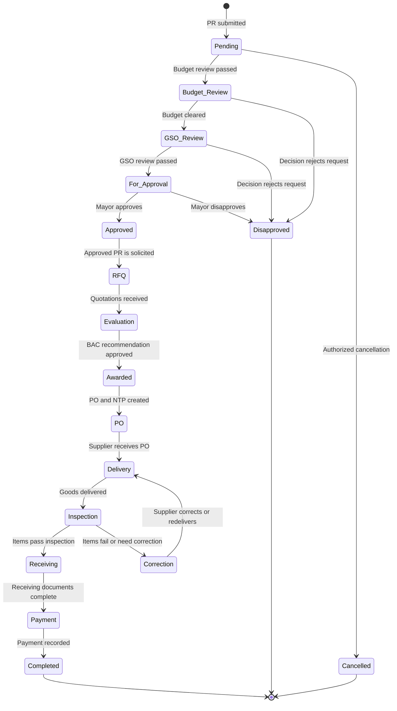
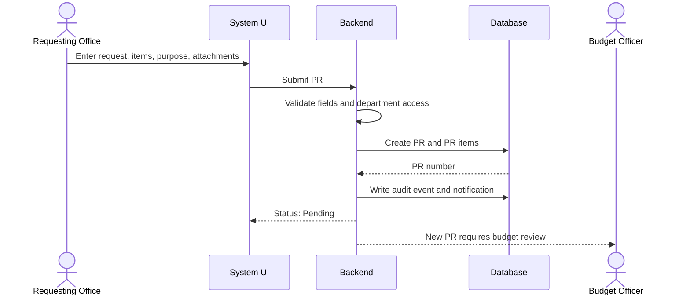
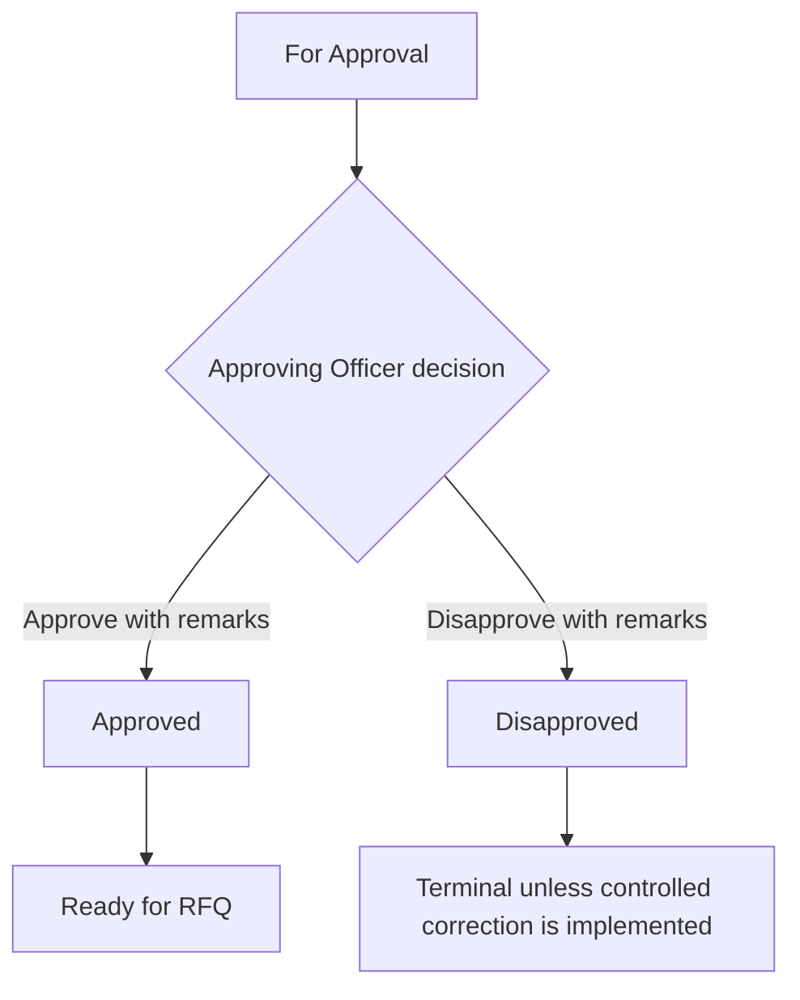
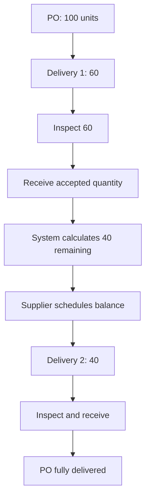
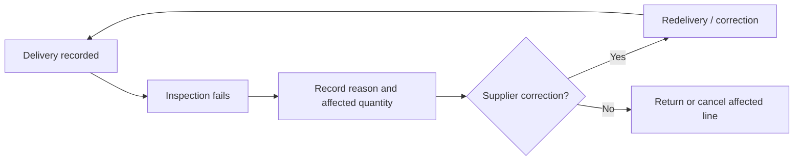
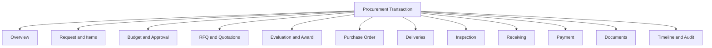

# GSO Procurement System Flow

## 1. Big Picture

The system moves one procurement transaction through controlled stages. Each stage has an owner, a required action, a status, a document, and a next responsible user.

```mermaid
flowchart LR
    A[Requesting Office<br/>Creates PR] --> B[Budget Officer<br/>Budget Review]
    B --> C[GSO Officer<br/>Technical and Procurement Review]
    C --> D[Mayor / Approving Officer<br/>Approve or Disapprove]
    D -->|Approved| E[GSO / BAC Secretariat<br/>Create RFQ]
    E --> F[Suppliers<br/>Submit Quotations]
    F --> G[BAC Secretariat<br/>Evaluate and Recommend]
    G --> H[Mayor / Authorized Officer<br/>Award]
    H --> I[GSO Officer<br/>Create PO and NTP]
    I --> J[Supplier<br/>Confirm and Deliver]
    J --> K[GSO / Inspector<br/>Inspect Delivery]
    K --> L[Receiving Personnel<br/>Accept Items]
    L --> M[Accounting / Finance<br/>Process Payment]
    M --> N[System<br/>Complete and Archive]
```



## 2. User Roles at a Glance

| User | Main responsibility | Typical actions |
|---|---|---|
| Requesting Office / End User | Identifies the need | Create PR, attach documents, submit, track, respond to returned corrections |
| Budget Officer | Confirms funding availability | Review budget, record ALOBS/budget remarks, forward or return |
| GSO Officer | Controls procurement operations | Review specifications, select procurement mode, create RFQ/PO, coordinate delivery, inspect/receive |
| BAC Secretariat | Manages solicitation and evaluation | Invite suppliers, record quotations, prepare abstract, record BAC resolution |
| Mayor / Approving Officer | Provides formal approval | Approve, disapprove, approve awards or administrative actions |
| Supplier | Offers and delivers goods | Submit quotation, confirm PO, deliver, correct rejected or incomplete delivery |
| Inspector | Determines whether delivered goods meet requirements | Inspect, pass, fail, partially pass, return for correction |
| Receiving Personnel | Officially accepts inspected goods | Receive accepted quantities and sign receiving record |
| Accounting / Finance | Processes payment | Verify documents, record payment, close financial obligation |
| Administrator | Maintains system control | Manage users, master data, settings, audit access |

> Supplier now has a separate authenticated portal for invited RFQs and quotation submission. Inspector, Receiving Personnel, and Property Custodian remain operational capabilities handled by GSO until separate role accounts are introduced.

## 3. Main Status Flow



## 4. Step-by-Step Flow by User

### Step 1: Requesting Office Creates a Purchase Request

**Starting point:** The office needs supplies, equipment, or services.

**User:** Requesting Office / End User

**Actions:**

1. Open **Procurement Requests**.
2. Select **New Purchase Request**.
3. Select the requesting department and section.
4. Enter the purpose or justification.
5. Add each item with description, quantity, unit, and estimated cost.
6. Attach supporting documents.
7. Review the total estimated amount.
8. Submit the request.

**System validation:**

- Department is required.
- Purpose and requester details are required.
- At least one item is required.
- Quantities and costs must be valid.
- End Users may create requests only for their assigned department.

**Result:**

- PR number is generated.
- Status becomes `Pending`.
- Audit event is recorded.
- Budget Officer receives a notification.



### Step 2: Budget Review

**Starting point:** PR status is `Pending`.

**User:** Budget Officer

**Actions:**

1. Open the action queue or PR directory.
2. Review the purpose, items, quantities, and estimated amount.
3. Confirm availability of funds.
4. Record ALOBS or budget reference when applicable.
5. Add remarks.
6. Choose the appropriate result.

**Possible results:**

- Advance to `Budget_Review` or the next configured budget-cleared state.
- Return for correction in the redesigned workflow.
- Disapprove when funding is unavailable or the request is invalid.

**Current implementation note:** The existing system uses `Pending` as the initial submitted state and advances through the backend PR transition rules. A dedicated `Returned` state is recommended but not yet implemented.

### Step 3: GSO Review

**Starting point:** The PR has passed budget review.

**User:** GSO Officer

**Actions:**

1. Verify the item description and technical specifications.
2. Check quantities against the procurement requirement.
3. Select the procurement mode.
4. Confirm the procurement schedule and required documents.
5. Add review remarks.
6. Forward the PR for approval.

**Result:**

- Status becomes `GSO_Review`, then `For_Approval` after forwarding.
- The next action is assigned to the Mayor or approving officer.

### Step 4: Approval

**Starting point:** PR status is `For_Approval`.

**User:** Mayor / Approving Officer

**Actions:**

1. Review the complete PR and previous remarks.
2. Verify the budget and GSO recommendation.
3. Select **Approve** or **Disapprove**.
4. Enter mandatory remarks.

**Result:**

- Approved: status becomes `Approved`; GSO/BAC receives the next action.
- Disapproved: status becomes `Disapproved`; the reason remains in the audit history.



### Step 5: RFQ and Supplier Solicitation

**Starting point:** PR status is `Approved`.

**User:** GSO Officer or BAC Secretariat

**Actions:**

1. Open the RFQ module.
2. Select an approved PR.
3. Set opening and closing dates.
4. Confirm terms and conditions.
5. Create the RFQ.
6. Invite eligible suppliers.

**System controls:**

- RFQ creation is rejected unless the linked PR is `Approved`.
- One PR cannot create duplicate RFQs.
- RFQ items are copied from the PR items.
- The RFQ receives a server-generated number.

**Result:**

- RFQ status becomes `Published`.
- Suppliers can be asked to submit quotations.

### Step 6: Supplier Quotation

**Starting point:** Supplier receives an RFQ invitation.

**User:** Supplier / Procurement Staff recording supplier response

**Actions:**

1. Review requested specifications and quantities.
2. Submit unit prices and total prices.
3. Submit required supplier documents.
4. Confirm whether each item is available and compliant.

**Result:**

- Quotation is linked to the RFQ and supplier.
- Late, incomplete, or non-responsive quotations are flagged.
- The RFQ closes after the deadline.

**Current implementation:** Invited suppliers can sign in, view only their RFQs, and submit a complete quotation before the closing date. The submission is stored with the supplier account and copied into the BAC abstract. BAC may still encode quotations for controlled legacy/manual cases.

### Step 7: Evaluation and BAC Recommendation

**Starting point:** RFQ is closed or quotations are ready for evaluation.

**User:** BAC Secretariat / BAC

**Actions:**

1. Compare supplier quotations item by item.
2. Check technical and documentary compliance.
3. Identify the lowest responsive quotation.
4. Record disqualified suppliers and reasons.
5. Prepare the Abstract of Canvass.
6. Record the BAC resolution and recommendation.

**Result:**

- Selected supplier is recorded.
- RFQ is closed.
- Notice of Award can be generated for the approved PR.

### Step 8: Award and Notice of Award

**Starting point:** BAC recommendation is complete.

**User:** BAC Secretariat / Authorized Officer

**Actions:**

1. Confirm winning supplier and justification.
2. Verify that the supplier belongs to the selected RFQ.
3. Create the Notice of Award.
4. Issue the award to the supplier.

**System validation:**

- The linked RFQ must exist.
- The linked PR must be approved.
- The winning supplier must match the BAC resolution.
- Award records must be auditable.

### Step 9: Purchase Order and Notice to Proceed

**Starting point:** Notice of Award is issued or accepted.

**User:** GSO Officer

**Actions:**

1. Select the approved PR, NOA, and supplier.
2. Confirm PO items and quantities.
3. Validate prices against the award.
4. Create the PO.
5. Generate the NTP.
6. Release the PO to the supplier.

**System validation:**

- PR must be approved.
- NOA must belong to the same PR and supplier.
- Duplicate PO conversion is rejected.
- PO quantities must be positive.
- PO and NTP creation is transactional.

**Current implementation note:** The present system creates a `Signed` PO and an `Issued` NTP during the PO operation. The redesigned flow should separate `PO Draft`, `PO For Approval`, `PO Approved`, `PO Released`, and `Supplier Confirmed`.

### Step 10: Supplier Confirmation and Delivery

**Starting point:** Supplier receives the released PO/NTP.

**User:** Supplier, coordinated by GSO

**Actions:**

1. Confirm the PO.
2. Schedule delivery.
3. Deliver the goods with invoice and delivery receipt.
4. Identify partial, complete, damaged, wrong, or backordered items.

**Quantity example:**

```text
Ordered:   100
Delivered:  60
Remaining:  40
```

The system must calculate remaining quantity as:

$$
\text{Remaining Quantity} = \text{Ordered Quantity} - \text{Cumulative Delivered Quantity}
$$

### Step 11: Inspection

**Starting point:** Delivery is recorded.

**User:** Inspector / GSO Inspection Personnel

**Actions:**

1. Compare delivered goods with the PO.
2. Check quantity, specification, quality, condition, and completeness.
3. Record inspection result per item.
4. Attach inspection evidence when required.

**Possible results:**

- Passed.
- Partially passed.
- Failed.
- For correction.
- Returned.

**Current implementation note:** The current IAR screen still combines delivery, inspection, acceptance, and inventory creation. Payment is blocked until the PO quantities are fully accepted; the target design still separates these actions into distinct Inspector and Receiving roles.

### Step 12: Receiving

**Starting point:** Items pass inspection.

**User:** Receiving Personnel / GSO

**Actions:**

1. Review inspected quantities.
2. Accept only quantities that passed inspection.
3. Record the receiving report.
4. Sign or confirm the receiving transaction.

The system must distinguish:

| Quantity | Meaning |
|---|---|
| Ordered | Quantity approved in the PO |
| Delivered | Quantity physically brought by the supplier |
| Inspected | Quantity checked by inspection personnel |
| Received | Quantity officially accepted by the organization |

Receiving must never exceed inspected quantity.

### Step 13: Inventory and Property Recording

**Starting point:** Items are officially received.

**User:** GSO / Property Custodian

**Actions:**

1. Register accepted equipment or property.
2. Generate property number.
3. Classify as ICS or PAR according to the approved rule.
4. Assign custodian or receiving office.
5. Record property movement history.

**Current implementation:** Accepted IAR items can create inventory assets. The target flow moves asset creation after a distinct receiving confirmation.

### Step 14: Payment

**Starting point:** Receiving documents and required financial documents are complete.

**User:** Accounting / Finance

**Actions:**

1. Verify PO, delivery, inspection, receiving, invoice, and supporting documents.
2. Record payment request.
3. Process disbursement and withholding where applicable.
4. Record payment reference and date.
5. Mark payment as completed only after actual financial confirmation.

**Important:** A PO or IAR must never automatically mean `Paid`.

**Current implementation note:** A complete payment workflow is not yet implemented. This is a critical outstanding module.

### Step 15: Completion and Audit

**Starting point:** All ordered quantities are received and payment is recorded.

**User:** System, GSO, Finance, Administrator

**System actions:**

1. Mark the transaction `Completed`.
2. Preserve all documents and revisions.
3. Display the full timeline.
4. Keep audit events immutable.
5. Retain the transaction for reporting and future audit.

## 5. What Each User Sees

### Requesting Office dashboard

- Requests returned for correction.
- Requests awaiting budget review.
- Current status of submitted requests.
- Next action and responsible office.
- PR, RFQ, PO, delivery, and receiving documents available to the department.

### Budget Officer dashboard

- PRs awaiting budget review.
- Budget certification tasks.
- Requests returned or disapproved.
- Budget-related reports and ALOBS references.

### GSO Officer dashboard

- PRs awaiting GSO review.
- Approved PRs ready for RFQ.
- RFQs requiring supplier coordination.
- Awards ready for PO.
- POs requiring release.
- Deliveries awaiting inspection or receiving.
- Inventory records requiring property action.

### BAC Secretariat dashboard

- Open RFQs.
- Quotations received.
- RFQs ready for evaluation.
- BAC resolutions awaiting completion.
- Awards awaiting Notice of Award.

### Mayor dashboard

- PRs awaiting approval.
- Awards or administrative actions requiring approval.
- Returned, rejected, cancelled, and overdue transactions.
- Approval history and audit timeline.

### Supplier dashboard

- RFQs invited to.
- Quotation deadlines.
- Submitted quotations.
- Released POs.
- Delivery schedules.
- Corrections or rejected deliveries.

### Accounting / Finance dashboard

- Transactions awaiting financial-document verification.
- Receiving records ready for payment.
- Payment requests in process.
- Completed and unpaid obligations.

### Administrator dashboard

- User and role administration.
- Master data and settings.
- Audit log search.
- Numbering and schema health.
- System notifications and failed integrations.

## 6. “What Should I Do Next?” Pattern

Every active transaction should display the following panel:

```text
Transaction: PR-2026-0001
Current status: FOR APPROVAL
Current step: Approval review
Next action: Approve or disapprove the request
Responsible user: Mayor / Approving Officer
Required documents: Approved PR, budget remarks, GSO review
Deadline: [Configured due date]
```

Examples:

| Current status | Next action | Responsible user |
|---|---|---|
| Pending | Verify budget availability | Budget Officer |
| Budget Review | Review specifications and procurement route | GSO Officer |
| GSO Review | Forward for approval | GSO Officer |
| For Approval | Approve or disapprove | Mayor |
| Approved | Create and send RFQ | GSO/BAC |
| Quotations Received | Evaluate supplier quotations | BAC Secretariat |
| Awarded | Create Notice of Award and PO | GSO/BAC |
| PO Released | Confirm delivery schedule | Supplier/GSO |
| Delivered | Inspect delivery | Inspector/GSO |
| Inspected | Record receiving | Receiving Personnel |
| Received | Verify and process payment | Accounting/Finance |
| Paid | Close and archive transaction | System/GSO |

## 7. Exception Flows

### Request returned for correction


### Partial delivery



### Failed inspection



### Cancellation

Cancellation must require authorization, a reason, and an audit event. It must not delete the PR, PO, delivery, inspection, or payment records already created.

## 8. Central Transaction View

The ideal transaction page is organized as follows:



The user should be able to search by PR number, RFQ number, PO number, supplier, requesting office, item, status, or date and then see the complete history in one place.

## 9. Simple User Journey Example

A requesting office needs 100 office chairs:

1. Requesting Office creates PR for 100 chairs.
2. Budget Officer confirms funds and records budget reference.
3. GSO Officer checks specification and selects procurement mode.
4. Mayor approves the PR.
5. GSO/BAC creates RFQ and invites suppliers.
6. Suppliers submit quotations.
7. BAC compares quotations and recommends the lowest responsive supplier.
8. NOA is issued.
9. GSO creates and releases PO for 100 chairs.
10. Supplier delivers 60 chairs.
11. Inspector checks and passes 60 chairs.
12. Receiving records 60 accepted chairs.
13. System displays 40 remaining.
14. Supplier delivers the remaining 40.
15. Inspector and Receiving accept the balance.
16. Finance verifies the complete documents and records payment.
17. System marks the transaction `Completed` and preserves the full audit timeline.

## 10. Current System versus Target System

| Area | Current system | Target system |
|---|---|---|
| PR guidance | New action queue now shows next action for supported PR states | Every module uses the same workflow metadata |
| RFQ gate | Approved PR required; duplicate RFQ prevented | Full RFQ lifecycle with supplier invitation and closing rules |
| PO | Relationship validation and transactional creation | Separate draft, approval, release, and supplier confirmation |
| Delivery | IAR records cumulative delivery quantities | Separate delivery receipt and delivery schedule |
| Inspection | Combined with IAR acceptance | Separate item-level inspection result |
| Receiving | Combined with IAR acceptance | Separate receiving record limited to inspected quantity |
| Inventory | Accepted IAR lines create assets | Assets created after formal receiving |
| Payment | Not yet a complete workflow | Finance-owned verification, payment, and completion |
| Tracking | PR tracker and module-specific lists | One transaction page and immutable timeline |
| Roles | Supplier role and portal are implemented; Inspector and Receiving remain GSO capabilities | Separate capabilities for requester, inspector, receiving, finance, property custodian, and supplier |

## 11. Golden Rule

At every point in the process, the system must answer four questions:

1. **Where is the transaction now?**
2. **Who is responsible for it?**
3. **What must that user do next?**
4. **What document or validation is required before it can move forward?**
